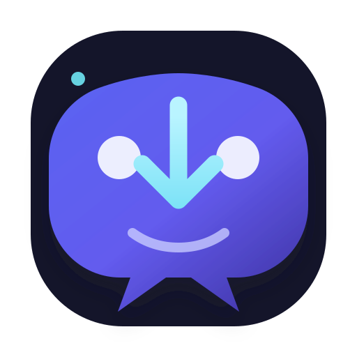
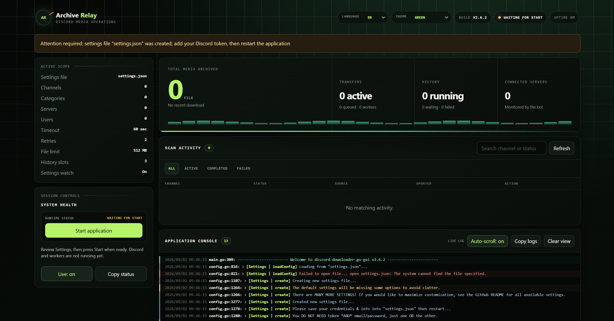

<p align="center">
  
</p>

<h1 align="center">Discord Downloader Go GUI</h1>

<p align="center">
  A focused desktop dashboard and Discord bot for reliable media archiving.
</p>

<p align="center">
  <a href="https://github.com/Halo1211/discord-downloader-go-gui/actions/workflows/ci.yml"></a>
  <a href="LICENSE"></a>
</p>

<p align="center">
  
</p>

A community-maintained Discord bot and desktop dashboard for downloading files
from Discord in real time and for archiving older channel history. The project
supports direct attachments, linked files, source resolvers, filtering,
deduplication, resumable history jobs, and a local configuration dashboard.

> **Important:** Use a genuine Discord bot account and bot token. Automated
> normal-user accounts (self-bots/user-bots) are not supported and can result
> in account termination by Discord.

This repository is the maintained GUI fork of
[`get-got/discord-downloader-go`](https://github.com/get-got/discord-downloader-go).
The canonical project repository, releases, and issue tracker are:
[`Halo1211/discord-downloader-go-gui`](https://github.com/Halo1211/discord-downloader-go-gui).

## Features

- Windows desktop dashboard with WebView2 and system-tray support.
- Embedded Archive Relay branding with a self-contained application logo.
- Logo colors adapt automatically to the selected dashboard theme.
- CLI mode for servers and headless environments.
- Real-time downloads with a bounded worker queue and retry backoff.
- Resumable history scans with cancellation and per-channel checkpoints.
- Atomic file, database-backup, and history-cache writes.
- Attachment, URL, emoji, sticker, and message-text handling.
- Per-user, server, category, and channel rules.
- File-type, extension, domain, phrase, role, reaction, and filename filters.
- Optional content-type subfolders, reactions, forwarding, and logging.
- JSON, JSONC, and YAML settings with a searchable GUI editor.
- Secrets are masked in the GUI and blank secret fields preserve stored values.

Supported source resolvers currently include direct file links, Discord
attachments, Twitter/X, Instagram, Imgur, Streamable, Gfycat, Tistory, and
Flickr. Logged-in source resolvers use unofficial integrations and may change
when the provider changes its website or API.

## Quick start

### 1. Create and invite a Discord bot

1. Open the [Discord Developer Portal](https://discord.com/developers/applications).
2. Create an application and add a bot.
3. Enable **Message Content Intent** under the bot's privileged intents.
4. Invite the bot to every server it must monitor.
5. Grant at least `View Channel` and `Read Message History`. Add `Send
   Messages`, `Add Reactions`, or attachment-related permissions only when the
   corresponding features are enabled.

The bot can only see channels in servers where it has been invited and granted
the required permissions.

### 2. Download a release

Download the single Windows amd64 executable from the
[latest GitHub release](https://github.com/Halo1211/discord-downloader-go-gui/releases/latest).
Extract it to a dedicated application directory. Rename the executable to
`discord-downloader-go-gui.exe` to use the commands below. Do not run the
program from a directory containing unrelated personal files.

### 3. Configure the bot

Copy [`settings.example.json`](settings.example.json) to `settings.json`, then
set the bot token and destination folder. The application creates a complete
settings file with defaults when no settings file exists.

On Windows, start the GUI executable from that directory:

```powershell
.\discord-downloader-go-gui.exe
```

The dashboard listens on `127.0.0.1:7744` by default. Review the settings and
press **Start application**. Set `guiAutoStart` to `true` when the dashboard
should start the runtime without a button press.

For a headless or terminal-only deployment:

```powershell
.\discord-downloader-go-gui.exe --no-gui
```

The GUI can also be opened in the system browser with `--gui-browser`. Useful
options include `--gui-address=127.0.0.1:8899`, `--no-gui-open`, `--no-tray`,
`--start-minimized`, `--gui-auto-start`, and `--config=my-settings`.

## Documentation

- [Getting Started](docs/GETTING_STARTED.md) — bot creation, permissions, and first run.
- [Settings Guide](docs/SETTINGS.md) — configuration structure, source rules, and tuning.
- [Commands Guide](docs/COMMANDS.md) — bot commands and history controls.
- [History Guide](docs/HISTORY.md) — archive scans, checkpoints, cancellation, and recovery.
- [Wiki hub](wiki/Home.md) — the complete guide set, including examples and troubleshooting.
- [Architecture Map](ARCHITECTURE.md) — runtime flow, state boundaries, and persistence.
- [Release Notes](RELEASE_NOTES.md) — changes planned for v1.0.1 and previous releases.

## Reliability and security defaults

Real-time downloads use four workers and a queue of 256 items by default. Each
response is limited to 512 MiB and follows at most five redirects. History
downloads use four workers and persist resumable checkpoints under
`cache/history/`. Signed Discord CDN query parameters are normalized for
deduplication, so refreshed attachment URLs do not create duplicate records.

The GUI binds only to loopback addresses, protects API calls with a random
per-process token, applies restrictive security headers, and masks credentials
when reading configuration. Keep the token out of screenshots, logs, backups,
and issue reports.

## Development

Requirements: Go 1.24.1 or newer and a working C compiler only when your
platform/toolchain requires one. Run the standard checks from the repository
root:

```powershell
go test ./...
go vet ./...
go build ./...
```

The GitHub Actions workflows run formatting, tests, vet, and builds for pushes
and pull requests. A tag matching `v*` publishes one Windows amd64 executable,
keeping the release download simple for the desktop GUI audience.

The project follows [Semantic Versioning](https://semver.org/) and
[Conventional Commits](https://www.conventionalcommits.org/).

## License and attribution

This project is released under the license in [LICENSE](LICENSE). It began as
a fork of [Seklfreak's discord-image-downloader-go](https://github.com/Seklfreak/discord-image-downloader-go)
and later became an independent maintained fork of
[`get-got/discord-downloader-go`](https://github.com/get-got/discord-downloader-go).
