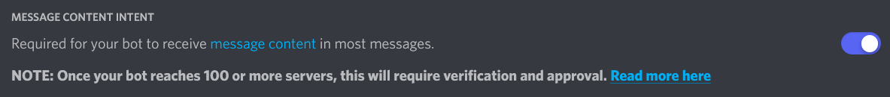
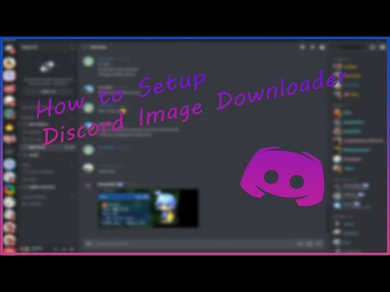

# Getting Started

This guide takes a new installation from a Discord bot application to the
first successful download. The maintained GUI fork uses a genuine bot account
and a bot token. It does not provide a supported user-account or self-bot
workflow.

## 1. Create the Discord application

1. Open the [Discord Developer Portal](https://discord.com/developers/applications).
2. Create an application and add a bot on its **Bot** page.
3. Copy the bot token once and store it like a password. Never place it in a
   public issue, screenshot, log, backup, or Git repository.
4. Enable **Message Content Intent** under **Privileged Gateway Intents**.
5. Invite the bot to a test server with the OAuth2 installation flow.

Discord's [bot quick start](https://docs.discord.com/developers/quick-start/getting-started)
explains the current Developer Portal layout. The [Gateway documentation](https://docs.discord.com/developers/events/gateway)
describes why message content is a privileged intent. Without it, Discord may
deliver empty message content and the program cannot reliably discover links.

## 2. Grant only the permissions you need

At minimum, the bot needs these permissions on every source channel:

| Permission | Required for |
| --- | --- |
| View Channel | Discovering and validating the channel. |
| Read Message History | `history` jobs and reading older messages. |
| Send Messages | Commands, status messages, and configured error replies. |
| Add Reactions | Optional download-success reactions. |
| Embed Links | Rich command/status replies when the channel allows embeds. |

Use channel-specific overwrites when an archive should be read-only. The
[official OAuth2 and permissions guide](https://docs.discord.com/developers/platform/oauth2-and-permissions)
recommends requesting only the permissions the app needs.

## 3. Install the single-executable release

Download the single Windows amd64 executable from the
[latest release](https://github.com/Halo1211/discord-downloader-go-gui/releases/latest)
and place it in a dedicated application directory. Keep `settings.json`,
`cache/`, `database/`, `backups/`, and archive folders beside it when using
relative paths.

Copy [`settings.example.json`](../settings.example.json) to `settings.json`,
then replace the token and destination placeholders:

```json
{
  "credentials": {
    "token": "your-bot-token"
  },
  "all": {
    "destination": "D:\\Discord Archive"
  }
}
```

For a safer first test, use one channel rule instead of `all`, and point it at
an empty test folder. See [Settings Examples](Settings-Examples.md).

## 4. Find Discord IDs

Enable **Developer Mode** in Discord under **User Settings → Advanced**.
Right-click a server, category, channel, or user and choose **Copy ID**. The
IDs are Discord snowflakes and must be kept as strings in JSON/YAML.

Use IDs in `servers`, `categories`, `channels`, or `users` rules when the
global `all` rule is too broad. A server rule can automatically cover its
channels; channel rules are useful for exceptions and separate destinations.

## 5. Start the application

On Windows, run the executable:

```powershell
.\discord-downloader-go-gui-v1.0.0-windows-amd64.exe
```

The dashboard opens on `127.0.0.1:7744` in a waiting state. Review the
configuration and press **Start application**. Keep `guiAutoStart` disabled
until a manual run has been verified.

Useful alternatives:

```powershell
# Terminal-only mode
.\discord-downloader-go-gui-v1.0.0-windows-amd64.exe --no-gui

# Use another settings base name
.\discord-downloader-go-gui-v1.0.0-windows-amd64.exe --config archive-test

# Open the dashboard in the system browser
.\discord-downloader-go-gui-v1.0.0-windows-amd64.exe --gui-browser
```

See [CLI and GUI](CLI-and-GUI.md) for all runtime flags and the local-only
binding rule.

## 6. Verify a live download

1. Confirm the log shows a successful Discord connection.
2. Confirm the dashboard shows the expected server and bound-channel counts.
3. Post a supported attachment or URL in the test channel.
4. Confirm the activity panel reports the transfer.
5. Confirm the file appears below the configured destination.

If the message is visible in Discord but nothing is saved, check the source
rule, `save`, the relevant `saveImages`/`saveVideos`/`saveAudioFiles` option,
filters, disk space, and the [Troubleshooting](Troubleshooting.md) guide.

## Reference visuals from the original wiki

The following public assets are retained as historical references from the
original [`get-got/discord-downloader-go` wiki](https://github.com/get-got/discord-downloader-go/wiki).
Discord changes its Developer Portal UI, so the written steps above are the
source of truth. Never copy a token from any screenshot.



The original wiki also published a setup video. It predates this GUI fork and
may show unsupported legacy flows; use it only for general orientation:

[](https://www.youtube.com/watch?v=06UUXDQ80f8)

The original wiki contained screenshots describing user-token extraction. They
are intentionally not reproduced here because this fork documents bot-only
operation and must not encourage self-bot authentication.

## Keep credentials safe

Never commit `settings.json`, tokens, cookies, passwords, databases, caches, or
downloaded private media. The GUI masks secret fields; leaving a masked field
blank preserves the existing secret when saving. Use
[`settings.example.json`](../settings.example.json) when sharing a template.
